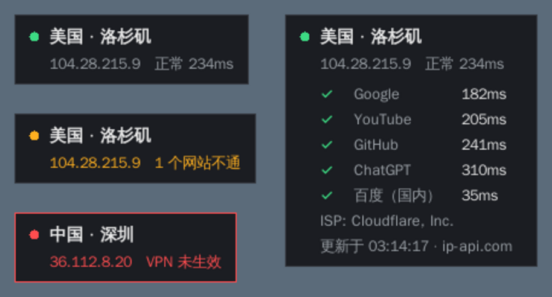

# NetWatch · 网络/VPN 状态小窗

一个**嵌在 Windows 任务栏里、托盘图标左边**的小部件，实时显示：

- 当前出口 IP 的**地点**（国家 · 城市）
- 网络/VPN 是否正常：常用网站能不能打开、延迟多少
- VPN 掉线、走了直连、换了节点时**变色 + 闪烁提醒**

点左侧的 `‹ ›` 可以在两种样式间切换：

- **展开**：像任务栏时钟一样的两行小字 —— 第一行地点，第二行状态
- **折叠**：只剩一个小圆点，🟢 正常 / 🟡 有问题 / 🔴 断开

它是任务栏的一部分（和 TrafficMonitor 的做法一样）：点任务栏不会被盖住或闪动，全屏看视频、玩游戏时随任务栏一起隐藏。配色自动跟随 Windows 的深色 / 浅色模式。



## 状态说明

| 圆点 | 文字 | 含义 |
|---|---|---|
| 🟢 绿 | `正常 234ms` | 所有网站都能打开，显示平均延迟 |
| 🟡 黄 | `1 个网站不通` / `网速较慢` | 部分网站打不开，或延迟超过 1.5 秒 |
| 🔴 红 | `VPN 可能断开` | 外网全都打不开，但国内网络正常 |
| 🔴 红 | `VPN 未生效` | 出口 IP 在国内（默认 CN）且外网打不开 —— 多半是 VPN 掉了走了直连 |
| 🔴 红 | `网络断开` | 连国内网站都打不开 |

出口 IP 一旦变化（换节点、VPN 掉线），圆点会闪烁几秒，详情里能看到「IP 变化：美国 · 洛杉矶 → 日本 · 东京」。

## 下载（Windows，免安装）

到 GitHub 仓库的 **Releases → latest** 下载 `NetWatch.exe`，双击运行即可，不需要安装 Python。
每次推送代码都会由 GitHub Actions 在 Windows 上自动重新打包（见 `.github/workflows/build-exe.yml`）。

> 首次运行时 Windows 可能弹出「Windows 已保护你的电脑」（exe 没有数字签名），点「更多信息 → 仍要运行」即可。

## 从源码运行

需要 **Python 3.8+**（Windows / macOS 官方安装包自带 tkinter，无需安装其它依赖）。

- **Windows**：双击 `run_windows.bat`（不会出现黑色命令行窗口）
- **macOS / Linux**：`./run_mac_linux.sh`，或 `python3 netwatch.py`

> Linux 如果提示缺少 tkinter：`sudo apt install python3-tk`

### 操作

| 操作 | 作用 |
|---|---|
| 点 `‹` / `›` | 展开 / 折叠成小圆点（会自动记住） |
| 单击圆点或文字 | 弹出详情（IP、ISP、每个网站的延迟、更新时间），再点一次关闭 |
| 左键拖动 | 移动位置，自动记住；拖到任务栏上会自动上下居中对齐 |
| 鼠标悬停 | 高亮并变为不透明 |
| 右键 | 菜单：立即刷新 / 显示详情 / 折叠展开 / 停靠到任务栏 / 嵌入任务栏 / 开机自启动 / 修改配置 / 退出 |

> 第一次运行会自动放到托盘图标左边。位置不理想就直接左右拖动，会记住；右键「停靠到任务栏」可恢复默认位置。
>
> 右键取消勾选「嵌入任务栏」会变回浮动的置顶小窗，可以拖到屏幕任意位置（但点任务栏时会被短暂盖住）。资源管理器重启后会自动重新嵌入。

### 开机自启动

右键 → 勾选「**开机自启动**」即可，再点一次取消。只对当前用户生效，不需要管理员权限：

- Windows：写入注册表 `HKCU\Software\Microsoft\Windows\CurrentVersion\Run`（也可以在「任务管理器 → 启动应用」里看到/关闭）
- macOS：`~/Library/LaunchAgents/com.netwatch.plist`
- Linux：`~/.config/autostart/netwatch.desktop`

开启后如果把 exe 挪到了别的文件夹，下次手动打开一次，启动项会自动更新为新位置。

### 打包成 exe（可选）

```bat
pip install pyinstaller
build_exe.bat
```

生成的 `dist\NetWatch.exe` 可以单独拷贝使用。

## 配置

配置保存在用户目录里，**不会在 exe 旁边（比如桌面上）产生文件**：

- Windows：`%APPDATA%\NetWatch\config.json`
- macOS：`~/Library/Application Support/NetWatch/config.json`
- Linux：`~/.config/NetWatch/config.json`

旧版本放在 exe 旁边的 `config.json` 会在启动时自动搬过去。右键 → 修改配置 可直接打开，改完后重启小部件生效：

```jsonc
{
  "interval_seconds": 30,        // 检测间隔（秒）
  "timeout_seconds": 6,          // 单次请求超时（秒）
  "opacity": 0.78,               // 浮动模式下的不透明度 0.2 ~ 1.0（嵌入任务栏时背景自动透明）
  "slow_ms": 1500,               // 超过这个延迟算“慢”
  "warn_countries": ["CN"],      // 出口 IP 在这些国家且外网不通时，判定为“VPN 未生效”
  "targets": [                   // 需要通过 VPN 访问的网站，可自行增删
    {"name": "Google",  "url": "https://www.google.com/generate_204"},
    {"name": "YouTube", "url": "https://www.youtube.com/generate_204"},
    {"name": "GitHub",  "url": "https://github.com"},
    {"name": "ChatGPT", "url": "https://chatgpt.com"}
  ],
  "domestic_target": {"name": "百度", "url": "https://www.baidu.com"},  // 用于判断是不是整个网络断了
  "theme": "auto",               // 配色：auto 跟随系统 / dark / light
  "collapsed": false,            // 是否折叠成小圆点
  "embed_taskbar": true,         // 嵌入任务栏（Windows）；false = 浮动置顶小窗
  "anchor": null                 // 位置，拖动后自动保存；null = 停靠在托盘左边
}
```

## 原理与注意事项

- **IP 归属地**依次尝试 ip-api.com、ipwho.is、ipinfo.io、ipapi.co，一个失败自动换下一个。
- **网站检测**：只要收到 HTTP 响应（哪怕是 403）就算“通”，超时 / DNS 失败 / 连接被重置才算“不通”。
- 程序会自动使用系统代理设置，所以无论 VPN 是 **TUN/全局模式** 还是 **系统代理模式**（Clash、v2rayN 等）都能检测。
- 如果 VPN 用的是**规则/分流模式**，查询 IP 的请求可能走直连，此时显示的会是你本地的 IP 和地点；只要外网网站都能打开，圆点仍然是绿色，不会误报。

## 开发

```bash
python3 -m unittest discover -s tests   # 运行测试（检测逻辑，不需要图形界面）
```

- `monitor.py`：检测逻辑（IP 查询、网站检测、状态判断），不依赖界面
- `netwatch.py`：tkinter 小窗界面
- `autostart.py`：开机自启动（注册表 / LaunchAgent / autostart）
- `desktop.py`：任务栏/托盘位置、嵌入任务栏、系统深浅色、全屏检测（Windows）
- `ci/windows_check.ps1`：在 Windows 构建机上检查 exe 能运行、确实嵌入了任务栏、资源管理器重启后能恢复
